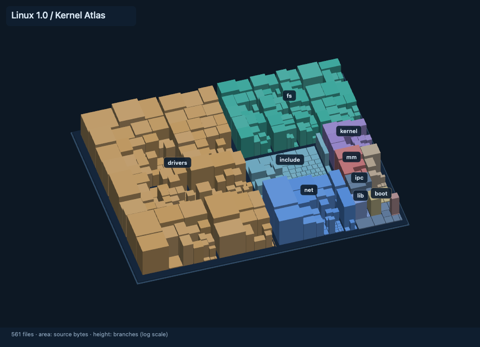

# Kernel Atlas

A native Apple Silicon Mac app for exploring the complete **Linux 1.0** kernel.
Built with SwiftUI, AppKit and a Metal-backed SceneKit renderer. The app is fully
local, includes its source corpus, and needs no account, network, Python runtime,
Rust toolchain or subscription to run.

Download `Kernel-Atlas-Mac.zip` from the
[GitHub releases](https://github.com/jakekinchen/kernel-atlas/releases), extract it,
and open `Kernel Atlas.app`. Requires macOS 14 or later on Apple Silicon.
The app is ad-hoc signed and is not notarized; macOS may require allowing it in
System Settings → Privacy & Security on first launch.

To build from source:

```sh
git clone https://github.com/jakekinchen/kernel-atlas.git
cd kernel-atlas
bash scripts/build.sh
open 'dist/Kernel Atlas.app'
```



## Explore

- **Landscape / Map:** two views of the same recursive squarified layout.
- **Drag:** orbit in Landscape, pan in Map. Shift-drag or right-drag pans.
- **Pinch / wheel / + / −:** zoom. Wheel and pinch zoom around the pointer. **0** fits the kernel; **F** focuses a selection.
- **Zoom into any file to read its source inside its box.** In Map mode, double-click a file (or press **F** on a selection) to jump to a readable size. A selected function focuses its own lines. Drag to read further through the map.
- Every file contains its entire source in stable columns with line numbers and syntax highlighting. Source-shaped marks become real text as you zoom closer. Long lines soft-wrap at 100 columns; nearby function boundaries guide column breaks.
- Click a file to inspect it. Hover reveals its path. The code toolbar button toggles source tiles separately from directory labels.
- Select a directory to isolate a neighborhood. Color identities stay stable.
- **⌘F:** search files and functions. Exact function matches come first.
- **Functions / Calls:** choose a definition, inspect incoming or outgoing named
  call sites, and follow a relationship to another definition.
- **⌘O / Read source:** open the original file at the selected definition.
- The connection control aggregates cross-file call relationships for the current
  function or file. It shows at most 28 neighbors; individual sites remain in the
  Calls inspector (first 300 shown for large selections).
- The three guided journeys follow boot and scheduling, virtual memory, and TCP/IP.
- The share button exports the current map as a PNG with labels and encoding notes.

## Why this codebase

Linux 1.0 is a complete, historically significant operating-system kernel small
enough to understand spatially: scheduling, virtual memory, filesystems, device
drivers, and TCP/IP all coexist in one compact source tree. It is a historical
reading corpus; Kernel Atlas does not build or run the old kernel.

The official kernel.org release archive contains **561 files, 4,719,743 bytes**
(4.72 decimal MB; approximately 5.7 MiB allocated on this Mac). That is the full
extracted corpus, including documentation and its original license, under the
requested **20,000,000-byte** limit. This is not a modern Linux kernel truncated
to meet the limit.

- Source: <https://www.kernel.org/pub/linux/kernel/v1.0/linux-1.0.tar.xz>
- SHA-256: `a1bc598111df3002271c367adddab978c42549db9f17e698dc7f65d4304ff5ed`
- The hash matches kernel.org's `sha256sums.asc`; the signed checksum document is
  retained in `research/`. The PGP signature was not separately authenticated.
- Original files are unchanged in `Corpus/linux`; `COPYING` remains included.

## Visual decisions implemented

1. **A stable map, before spectacle.** Recursive squarification preserves the
   directory hierarchy. Footprint reflects original bytes before directory padding.
2. **Height conveys information.** Branches, lines, or function counts determine
   height with a documented logarithmic scale. Branches count parsed conditionals,
   loops, cases and ternaries; they are not a formal cyclomatic-complexity score.
3. **Labels respond to scale.** Native screen-space text stays readable. Collision
   avoidance reduces clutter; subdirectories and file names appear on closer views.
4. **Connections answer a question.** Selection-driven, aggregated arcs reveal
   relationships without turning the whole kernel into a permanent hairball.
5. **Guided reading gives the picture meaning.** Every journey stop opens an actual
   definition in the original source. A journey is an editorial reading route, not
   a claim that every consecutive stop is a direct function call.
6. **A quiet shell around the map.** Restrained typography, subsystem colors,
   orthographic geometry, and no decorative perpetual animation.

## Index boundaries

The offline index uses pinned Tree-sitter C versions. It records parsed function
definitions, branch nodes and named call expressions. A call resolves to a same-file
definition first, or a unique non-static definition across the corpus. It omits
unresolved and ambiguous targets. This is useful syntax navigation, **not a
compiler-resolved reference graph**. Conditional compilation, macros, shadowing,
inline assembly, and function pointers remain incomplete.

The parser input normalizes the historical `asmlinkage` annotation and blanks
`_syscallN` macro-invocation lines while preserving offsets and line numbers.
The bundled source is not modified. The index contains 3,199 parsed functions,
12,101 resolved named call sites, 9,687 unresolved named call sites and 714 parser
error nodes. Those limitations are also visible in the app's About panel.

## Build and verify

Requires Xcode's command-line tools and macOS 14 or later on Apple Silicon.
The normal build has no third-party dependencies:

```sh
bash scripts/build.sh
open 'dist/Kernel Atlas.app'
```

To recreate the index (only development needs Python):

```sh
python3 -m venv .venv
.venv/bin/pip install -r scripts/requirements.txt
.venv/bin/python scripts/index_kernel.py
.venv/bin/python -m unittest discover -s Tests -v
bash scripts/build.sh
```

To run the native verification and completed-render benchmark:

```sh
open -n 'dist/Kernel Atlas.app' --args --verify "$PWD/evidence/manual"
```

`evidence/source-tiles-final/app-verification.json` records the latest release checks and render
measurements. Timings are completed offscreen frames at 1440×1000 with 4× MSAA,
including image readback. They do not establish the display's refresh rate or a
guarantee of 120 Hz. The app requests up to 120 fps during interaction and uses
on-demand rendering while idle. No giant tile cache or database is needed for this
4.72 MB corpus: the mesh is batched, the index is decoded once, and only six source
documents are cached by the separate reader. The source tile layer has its own bounded
cache, described below. A larger corpus would need a different indexing strategy.

The app is ad-hoc signed for local use, not notarized for public distribution.
The viewer is tailored to this bundled Linux corpus; importing arbitrary projects
and language-server-quality semantic references are future features.

## Makepad research

The public [Director README](https://github.com/makepad/makepad/blob/work/apps/director/README.md)
explicitly identifies Scope as private; `apps/scope` was absent from the public
`work` branch's apps listing checked on 2026-09-13. Director and `makepad-diskmap`
are public foundations, but they do not supply the complete Scope explorer.
The local research snapshots retain the README, directory listing and diskmap
package metadata. The supplied anecdotal 21 GB / 120 Hz and Chromium memory figures
were not independently verified and are not performance claims for this app.

For this Mac-only deliverable, Apple's native frameworks provided a compact,
dependency-free runtime and direct Metal rendering. This is an original app inspired
by Scope, with no claim to be Rik Arends' private product and no copied Scope code.
SceneKit is a mature Apple framework now marked deprecated; it remains available
on the tested macOS 26.6.2. A long-lived cross-platform version should evaluate
Makepad or a dedicated Metal renderer before expanding its engine requirements.

Linux source retains its original GPL-2.0 license in `Corpus/linux/COPYING`.


## Measured on this Mac

The final installed build ran on Apple M3 Ultra / macOS 26.6.2. Its verification run
passed 25 native checks, decoded the index in 22.9 ms, and completed 1440×1000
scene renders at 2.51 ms median / 3.02 ms p95, including readback. Source plus scene
composition at 938×678 took 5.75 ms median / 6.68 ms p95 with a warm cache over
20 camera updates, including readback and excluding PNG encoding. An earlier idle process
sample showed 0.0% CPU and 129.5 MiB RSS before opening source documents; later
interactive samples used more memory. These are bounded local measurements, not
refresh-rate guarantees or large-repository benchmarks. Five Python index tests
also passed. The UI was exercised for journeys, search, source, call navigation,
and PNG export.


## Source inside every tile

The source layer uses native CoreText vector glyphs, with no fixed-resolution
full-file texture. It draws only visible rows and columns in visible files, keeps
at most 20 prepared documents and 1,536 shaped rows, and leaves the renderer idle
when the view is unchanged. Zoom can go much deeper than the original overview.
Map mode provides unobstructed reading; source also appears on exposed 3D roofs.
Original source bytes are unchanged. The separate source reader remains available.

The final follow-up verification lives in `evidence/source-tiles-final/`, including unselected
source, `schedule()` at line 211 with its body, the final source line, an exposed
3D roof, source-cache checks, and pointer-anchored zoom. The source benchmark includes
both the scene readback and native source/label composition, excluding PNG encoding.
The installed app was also exercised through native UI: scroll zoom, larger text,
two-axis source panning, and `source-live-map.png` exported through its Save dialog.
